# PBCrossAppUniqueDeviceIdentifier 功能流程图

按当前源码整理，更新于 2026-11-04，包含本轮 P2 修复。图中的步骤表示当前实现；升级、跨 App 和兼容接口的边界列在第 10 节。

本文使用 Mermaid，可在支持 Mermaid 的 Markdown 阅读器中查看和维护。

## 导航

1. [功能总览](#1-功能总览)
2. [配置更新](#2-配置更新)
3. [身份加载、缓存与结果交付](#3-身份加载缓存与结果交付)
4. [共享 ID 读取与原子创建](#4-共享-id-读取与原子创建)
5. [设备属性采集与版本指纹](#5-设备属性采集与版本指纹)
6. [远端解析](#6-远端解析)
7. [广告授权与广告请求输出](#7-广告授权与广告请求输出)
8. [归因匹配](#8-归因匹配)
9. [缓存重置、身份清理与服务端注入](#9-缓存重置身份清理与服务端注入)
10. [当前实现边界](#10-当前实现边界)
11. [线程与源码索引](#11-线程与源码索引)

## 1. 功能总览

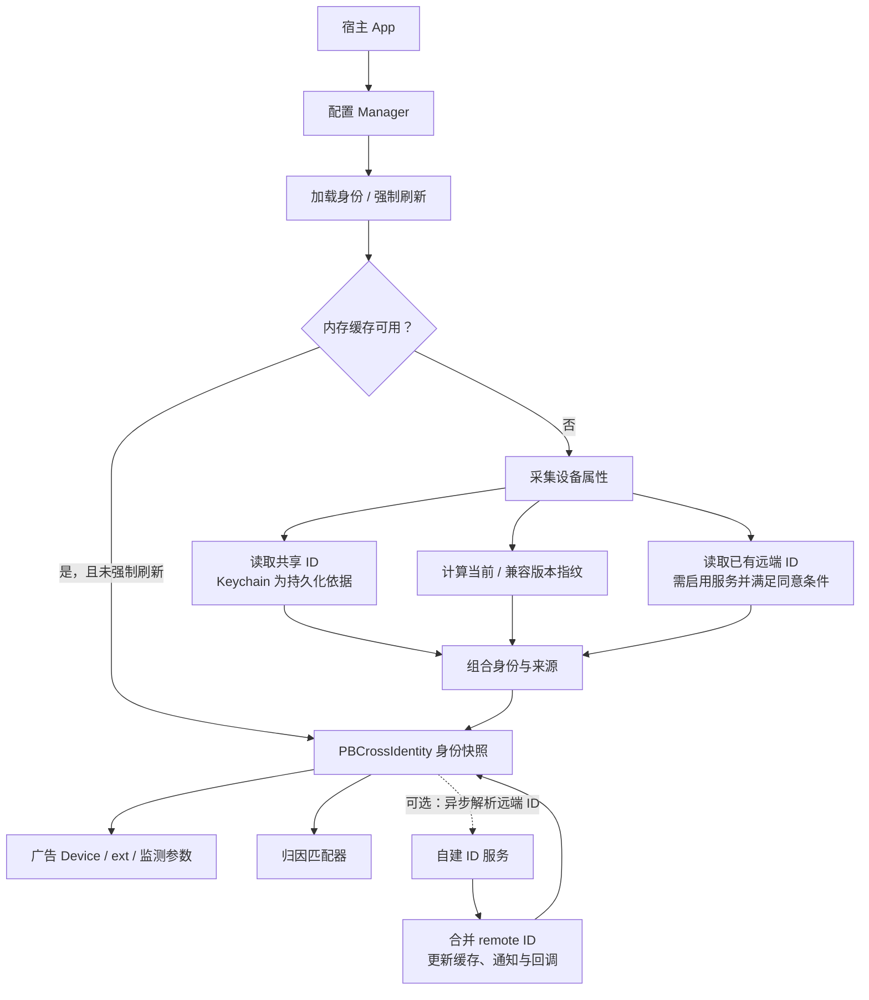

身份快照同时容纳多类标识，不是只选择其中一种：

| 数据 | 来源与用途 |
| --- | --- |
| `sharedID` / `shared_id` | 服务端显式注入的共享 ID 优先，否则使用 Keychain 自建 UUID；同 Team 可通过共享 Access Group 共享。 |
| `identifiers` 中的 `fingerprint` | 每个受支持版本独立计算；默认包含当前版本 `20261001` 和兼容版本 `20260301`。 |
| `identifiers` 中的 `remote` | 自建远端服务返回的版本化 ID；与本地指纹并存，不自动覆盖 `sharedID`。 |
| `attributes` | 设备属性；可选 IDFA MD5 用于匹配和广告输出，默认指纹字段不含 IDFA。 |

`currentIdentifier` 优先选择第一个本地指纹；`previousIdentifier` 选择后续第一个本地指纹。只有没有本地指纹时，`currentIdentifier` 才回退到标识数组首项。指纹是属性计算结果，不保证全局唯一或永久不变。

## 2. 配置更新

入口：`configureWithBlock:error:`。

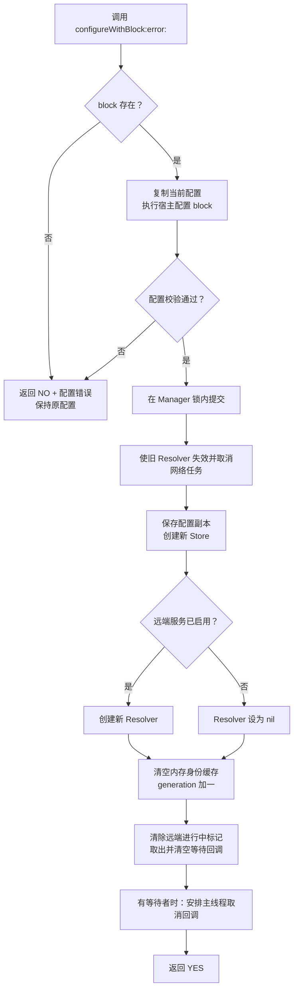

主要校验包括：salt 非空、版本数组非空、版本名和字段集有效且版本名不重复、Keychain service 非空、缓存时长非负，以及已启用远端服务的静态配置有效。配置 App Group 时必须同时配置共享 Keychain Access Group；仅 App Group 会校验失败。

重新配置不删除已有 Keychain 或 Defaults 数据。`generation` 用于阻止旧配置的加载结果提交到当前内存缓存、回调或通知；持久化边界见第 10 节。

## 3. 身份加载、缓存与结果交付

### 3.1 本地加载主流程

入口：`loadIdentityWithCompletion:`、`refreshIdentityWithCompletion:`、`identitySynchronously`。

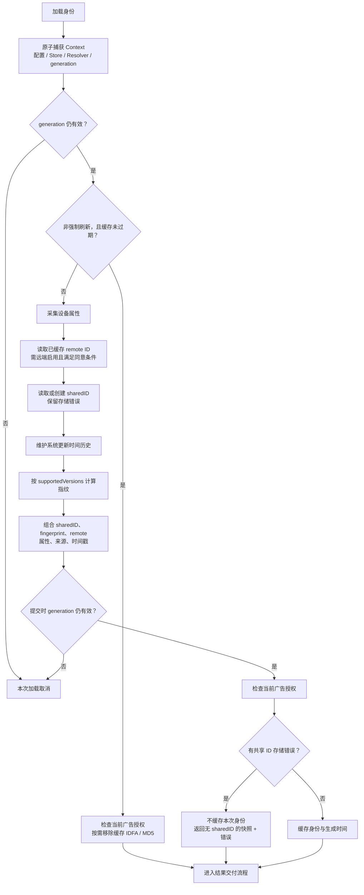

- 普通加载优先使用内存缓存，默认有效期 300 秒；设为 0 表示每次重新采集。
- 强制刷新绕过内存缓存，但仍使用持久化共享 ID 和已缓存的远端 ID，不强制发起网络请求。
- 本地加载允许带入已过期的远端缓存；远端 TTL 用于决定是否需要后台刷新，而不是立即删除旧远端 ID。
- `cachedIdentity` 返回最近快照，不检查缓存时效，但会检查当前广告授权。

### 3.2 同步、异步与取消

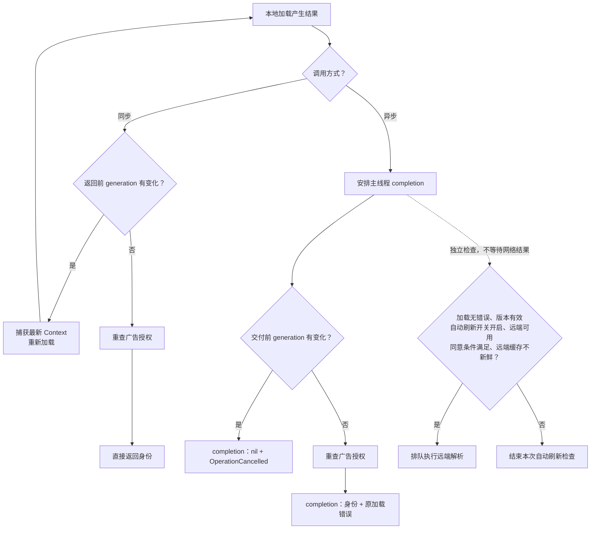

同步加载本身不触发自动远端请求。若 Keychain 失败，同步接口返回不含共享 ID 的快照，错误详情需通过异步加载获取。

## 4. 共享 ID 读取与原子创建

### 4.1 服务端 ID 优先

入口：Store 的 `sharedIDCreatingIfNeeded:serverIssued:error:`；Manager 的 `sharedID` 属性会以 `create=YES` 调用。

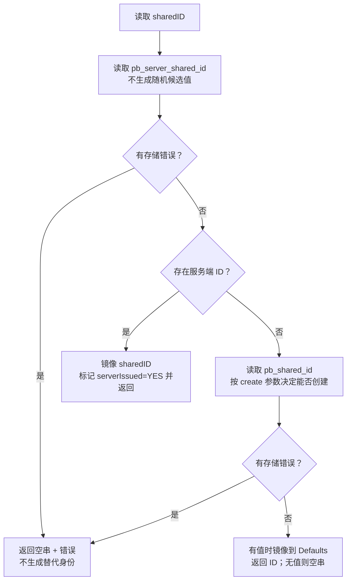

### 4.2 单个 Key 的读取和原子新增

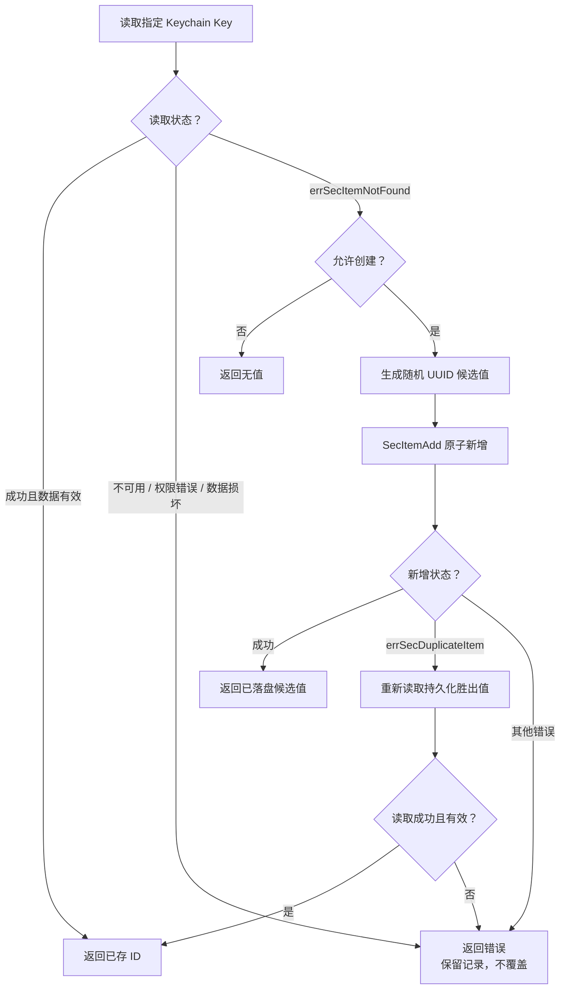

并发首次创建依靠 Keychain 的原子新增确定胜出值，不返回未保存的随机候选值。Defaults 仅作镜像，并按 service/accessGroup 隔离；Keychain 缺失时不会从任何旧镜像恢复 ID。已有 Keychain 记录沿用，旧 Defaults 单独存留的 ID 不再迁移。

## 5. 设备属性采集与版本指纹

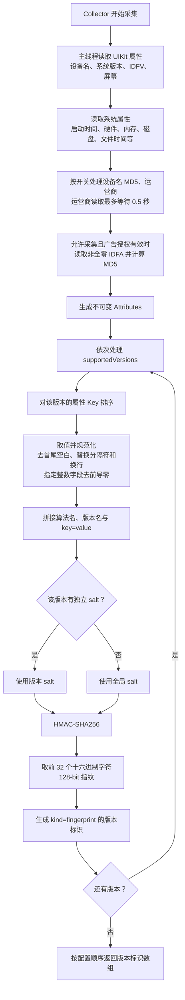

规范字符串形式为：`pb-xid-v1|版本名|key=value|key=value`。缺失属性按空串参与；默认当前版本包含启动时间，设备重启后指纹会轮换。跨公司复现要求版本、字段集、salt、采集开关和实际采集值一致，详见 [算法规范](CrossCompanyIdentifierSpec.md)。

## 6. 远端解析

### 6.1 入口、请求合并与发起网络请求

入口：显式 `resolveRemoteIdentityWithCompletion:`，或异步本地加载后的自动刷新。

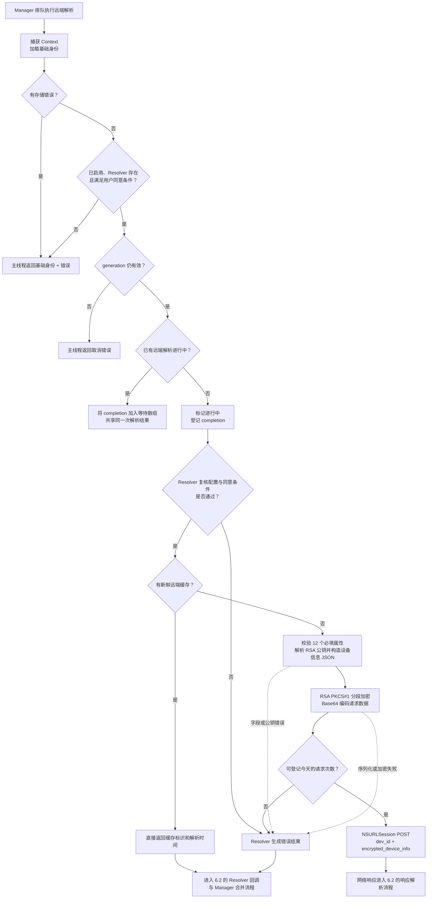

新鲜度默认 TTL 为 24 小时，请求上限默认每天 5 次，按设备本地日期计数。缓存和计数使用 `developerID + endpointURL` 派生的作用域。登记次数发生在网络请求前，网络失败也消耗已登记次数。

远端用户同意配置与 ATT 是两个独立条件。该请求使用 CAID 兼容设备信息字段，不包含 IDFA；SDK 默认关闭远端服务。

### 6.2 响应、持久化、合并与通知

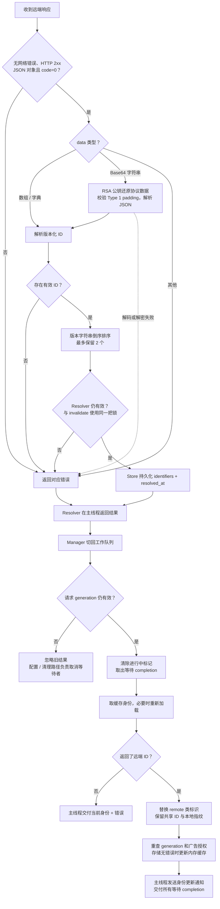

Manager 在重建、提交和主线程交付时也会复核 generation；期间版本变化时，已取出的等待回调仍会收到取消结果。配置更新、清理和成功注入会使旧 Resolver 失效并取消任务；失效与持久缓存写入互斥。清理在旧 Resolver 失效后删除缓存，再创建新的 Resolver，因此迟到响应无法重新填回旧数据。请求计数登记与任务发起也在失效锁内复核有效性。

## 7. 广告授权与广告请求输出

### 7.1 IDFA 采集及授权撤回

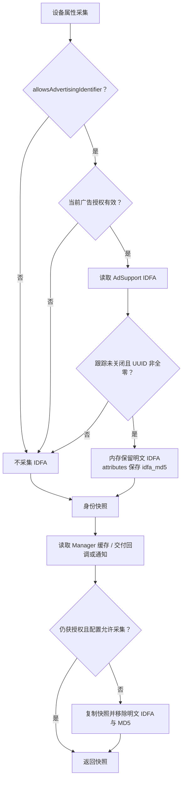

iOS 14 及以上检查 ATT `authorized`；更早系统检查广告跟踪开关。框架不可用时按未授权处理。SDK 不主动弹出 ATT；授权请求由宿主处理。已交付给宿主的快照不可变，宿主须停止使用自己的旧快照；重新授权后需强制刷新才能重新采集。

### 7.2 广告适配与导出

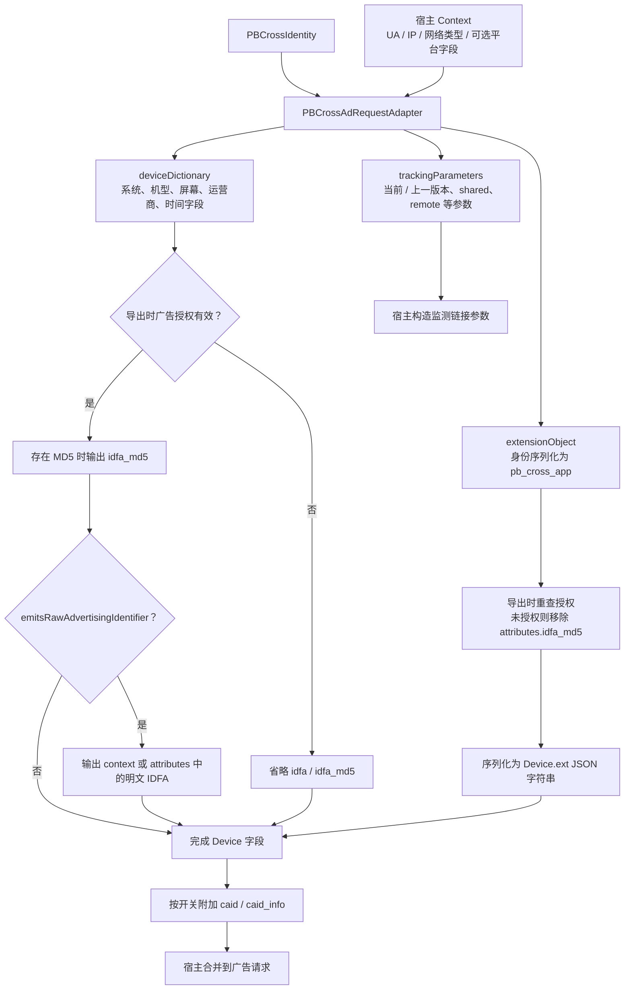

Manager 工厂会获取当前身份并设置输出开关；手动创建适配器时使用调用方传入的快照。适配器会复制 Context，导出本身不发送网络请求。明文 IDFA 和旧版 CAID 字段默认均不输出。`deviceDictionary` 的 `ext` 为 JSON 字符串，`extensionObject` 为字典。

## 8. 归因匹配

入口：`matchIdentity:withIdentity:`。媒体回传的 `Device.ext` 可先通过 `identityWithAdRequestExtension:` 还原身份。

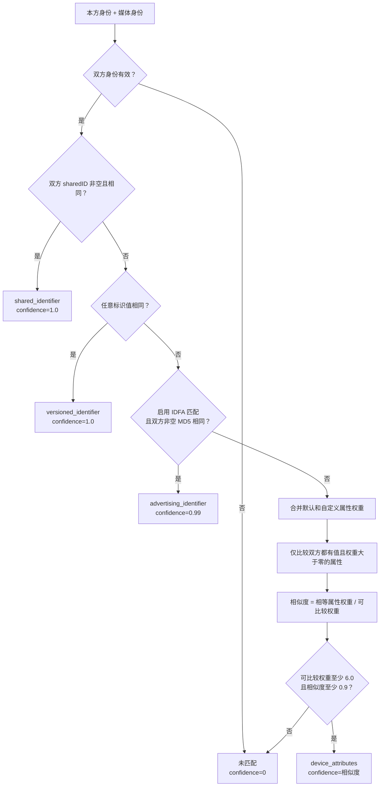

阈值和最小可比较权重可配置。共享 ID、版本标识和 IDFA MD5 的字符串比较均忽略大小写；版本标识匹配实际比较 `value`，不会额外要求 `version` 或 `kind` 相等。属性匹配会规范化部分数字字符串并输出逐字段比较结果。

匹配器消费传入快照，不在匹配时读取实时 ATT。图中 confidence 是当前代码返回的分值，不是经过统计校准的“同设备概率”。

## 9. 缓存重置、身份清理与服务端注入

### 9.1 重置内存缓存与清除持久身份

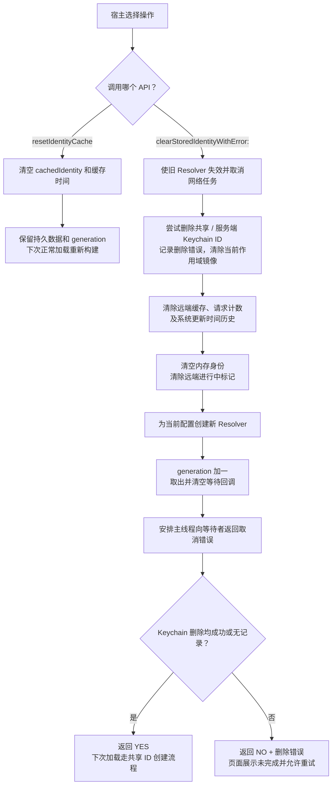

当前清理只移除当前 Keychain 命名空间内的 SDK 镜像、远端缓存、请求计数和系统更新时间历史。`resetIdentityCache` 不使在途任务失效；在途任务随后仍可能重新填充内存缓存。旧 `clearStoredIdentity` 保留兼容，但不返回删除错误；需要确认结果时使用 `clearStoredIdentityWithError:`。

### 9.2 显式注入服务端共享 ID

入口：`setServerIssuedSharedID:`。此接口与远端 Resolver 返回 `remote` 标识是两条独立路径。

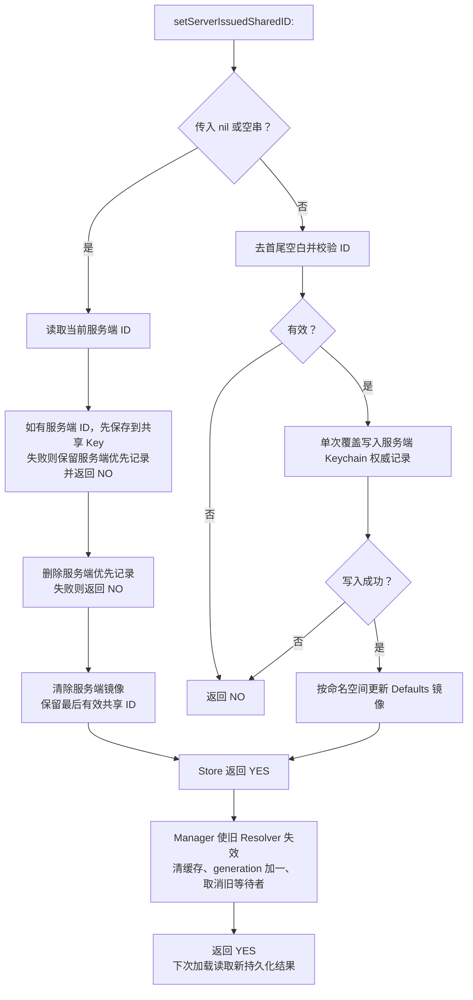

注入非空值只写入服务端权威 Key，避免双写部分失败。传入空值会先把最后有效服务端 ID 保存在共享 Key，再移除优先记录，不主动轮换成随机 UUID；任一步骤失败都会返回 NO，服务端优先记录保留。成功变更会增加 generation，使旧加载结果失效。

## 10. 当前实现边界

本轮 P2 已按以下规则修复，使用时仍需理解接口范围。

| 关联流程 | 当前行为与边界 |
| --- | --- |
| 镜像与升级 | Keychain 是身份依据，旧 Defaults 不再自动恢复到 Keychain；仅存于旧镜像的 ID 不会继续沿用。 |
| 命名空间 | Defaults 使用 service/accessGroup 派生的前缀；其他命名空间的身份和镜像不受当前清理影响。旧无命名空间记录被忽略。 |
| 服务端注入 | 单条权威 Key 写入；成功后取消旧任务和等待者。空值用于移除优先标记，失败保持最后有效身份。 |
| 远端失效 | 同一 Manager 内，清理/配置/注入与旧 Resolver 的持久缓存提交互斥；不提供跨进程网络任务取消。 |
| 清理结果 | 新增带错误接口；删除失败可能已完成部分清理，应处理错误后重试。旧无错误接口仅作兼容。 |
| 其他 App | 清理共享记录影响后续持久化读取；不会主动清除其他进程已持有的内存身份快照，宿主须刷新。 |

## 11. 线程与源码索引

| 阶段 | 当前线程行为 |
| --- | --- |
| 配置、清理、服务端注入 | 在调用线程执行，关键状态由锁保护。 |
| 异步加载与 Manager 远端调度 | Manager 的串行 `workQueue`。 |
| 同步加载 | 主线程或 Manager 工作队列中直接执行；其他线程同步派发到工作队列。 |
| UIKit 属性读取 | 采集器同步切换到主线程。 |
| 运营商读取 | 独立串行队列，采集器最多等待 0.5 秒。 |
| 网络响应解析与持久缓存 | NSURLSession 回调线程；Resolver 再将结果派发到主线程。 |
| 远端身份合并 | Manager 将 Resolver 结果重新派发到 `workQueue`。 |
| 异步 completion / 身份更新通知 | 主线程，交付前复核版本与广告授权。 |
| 广告导出 / 匹配 | 调用线程执行，不自行发起网络请求。 |

| 功能 | 主要源码 |
| --- | --- |
| 入口、配置、缓存、generation、远端结果合并 | [PBCrossAppUniqueDeviceIdentifierManager.m](../Sources/Implementation/PBCrossAppUniqueDeviceIdentifierManager.m) |
| 配置校验与默认参数 | [PBCrossConfiguration.m](../Sources/Implementation/PBCrossConfiguration.m) |
| Keychain、Defaults、远端缓存与计数 | [PBCrossIdentityStore.m](../Sources/Implementation/PBCrossIdentityStore.m) |
| 属性采集 | [PBCrossDeviceAttributeCollector.m](../Sources/Implementation/PBCrossDeviceAttributeCollector.m) |
| 指纹计算 | [PBCrossIdentityGenerator.m](../Sources/Implementation/PBCrossIdentityGenerator.m) |
| 广告授权检查 | [PBCrossAdvertisingAuthorization.m](../Sources/Implementation/PBCrossAdvertisingAuthorization.m) |
| 远端协议 | [PBCrossRemoteResolver.m](../Sources/Implementation/PBCrossRemoteResolver.m) |
| RSA 协议处理 | [PBCrossRSACrypto.m](../Sources/Implementation/PBCrossRSACrypto.m) |
| 广告 Device、ext、监测参数 | [PBCrossAdRequestAdapter.m](../Sources/Implementation/PBCrossAdRequestAdapter.m) |
| 身份选择与序列化 | [PBCrossIdentity.m](../Sources/Implementation/PBCrossIdentity.m) |
| 归因匹配 | [PBCrossIdentityMatcher.m](../Sources/Implementation/PBCrossIdentityMatcher.m) |
